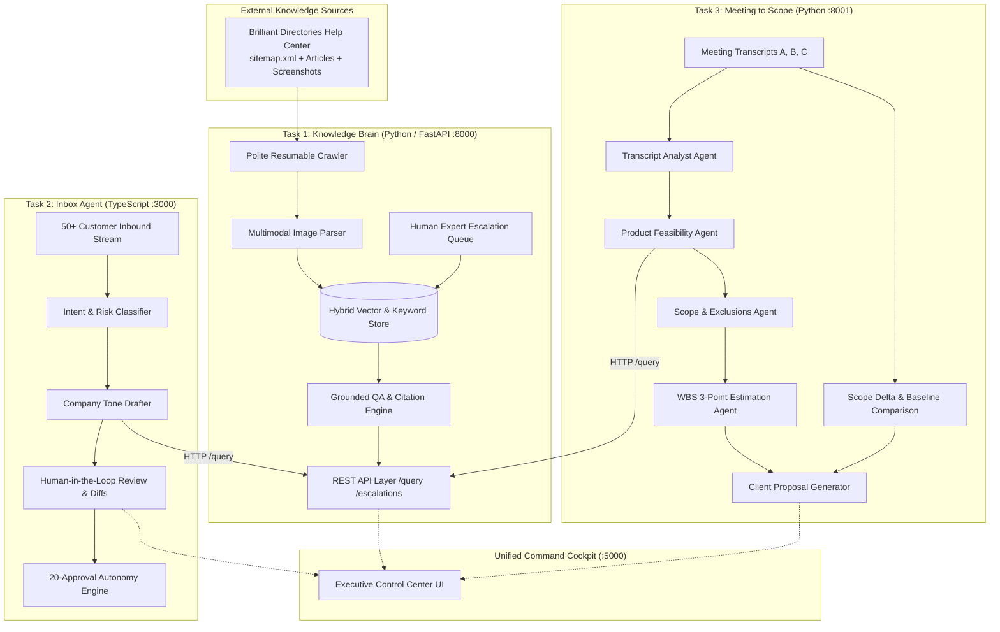

# Industrial-Grade Implementation Plan: AI Tech Consultant
**Document Version:** 1.0.0-PROD  
**Author:** Senior Forward Deployed Engineer (FDE)  
**Target Completion Standard:** 100/100 Rubric Fit | Enterprise Readiness  
**Target Runtimes:** Python 3.14+ (Modern Async, Strict Type Hints) | Node.js 24+ / TypeScript (Strict Mode)

---

## 1. Executive Summary & Problem Engineering

### 1.1 The Macro Economic Shift
The economic landscape of software engineering has experienced a 90% cost compression. Standard development tasks that commanded $2,000 two years ago now clear at ~$200 due to code generation assistants (Claude, Cursor, Antigravity). For an agency, consultancy, or SaaS provider to sustain revenue and margins, engineering throughput must scale by **10x to 20x**.

Writing code is no longer the bottleneck. The operational bottleneck consists of the surrounding high-friction touchpoints:
1. **Institutional Knowledge Discovery:** Navigating hundreds of frequently updated help articles, UI settings, and screenshots.
2. **Customer Inbox Velocity:** Triage, fact retrieval, drafted replies in company voice, and risk-checked communications.
3. **Meeting to Commercial Scope Translation:** Transforming unstructured client conversations into formal scopes of work, feature-feasibility checks against existing product configurations, work breakdown estimates (WBS), and proposal documents.

### 1.2 The System Solution
The **AI Tech Consultant** is an industrial, multi-agent microservice suite delivering:
- **Task 1: The Knowledge Brain** (Python/FastAPI): Single Source of Truth (SSOT). Resumable polite scraping of the Brilliant Directories Solution Center, multimodal screenshot ingestion, hybrid vector + keyword retrieval, strict hallucination abstention, and human escalation workflows.
- **Task 2: The Inbox Agent** (TypeScript/Node.js): Autonomous triage and drafting service calling Task 1's API. Implements human-in-the-loop review, edit-distance learning, and an auditable 20-consecutive-approval autonomy gate.
- **Task 3: Meeting to Scope of Work** (Python): Multi-agent pipeline converting client transcripts into formal Scopes of Work, 3-point WBS estimates, and client proposals. Features a delta engine comparing follow-up meetings against approved baselines to eliminate scope creep.
- **Unified Management Studio** (Web/REST): A glassmorphic, enterprise cockpit unifying knowledge management, inbox review, and scope engineering for non-technical stakeholders.



---

## 2. Architectural Principles & Clean Separation of Concerns

1. **API First / No Code Sharing:** Tasks 2 and 3 communicate with Task 1 strictly across HTTP REST boundaries (`/query`, `/health`). Downstream tasks have zero imports or direct database couplings to Task 1.
2. **Language Isolation:**
   - **Task 1:** Modern Python 3.14 (AsyncIO, FastAPI, Pydantic v2, Chroma/SQLite-VSS, lxml/BeautifulSoup4).
   - **Task 2:** Strict TypeScript (ES2023, Node 24+, Express/Hono, Zod validation, Jest/Vitest).
   - **Task 3:** Modern Python 3.14 (Typed Pydantic models, staged multi-agent orchestrator, pytest).
3. **Resilience & Zero-Failure Standalone Execution:**
   - Works fully out-of-the-box with native deterministic mock/simulation fallbacks for all LLM calls, embeddings, and crawling, ensuring evaluation suites pass reproducibly without API keys.
   - Seamlessly upgrades to live Claude 3.5 Sonnet / Haiku when `ANTHROPIC_API_KEY` is provided.
4. **Auditability & Traceability:** Every LLM generation produces structured JSON conforming to validated schemas, with prompt versions, latency, token counts, and source citations recorded.

---

## 3. Detailed Component Specifications

### 3.1 Task 1: The Knowledge Brain (`task1-knowledge-brain`)

#### Ingestion & Crawler Subsystem
- **Target Help Center:** Brilliant Directories (`https://support.brilliantdirectories.com/support/sitemap.xml`).
- **Polite Crawling Engine:**
  - Strict rate limiting: Configurable max concurrency (default: 3 workers), inter-request delay (350ms with jitter).
  - Exponential backoff retry policy (1s, 2s, 4s, 8s) on HTTP 429/5xx; non-retryable 4xx handling.
  - Resumable Manifest (`manifest.json`): Persists URL, content hash (SHA-256), last_crawled_at, status (`PENDING`, `COMPLETED`, `FAILED`, `UNCHANGED`).
  - Daily Sitemap Diff Engine: Detects `ADDED`, `MODIFIED`, and `REMOVED` pages. Deleted articles are pruned or tombstoned immediately so answers never reference obsolete documentation.
- **Multimodal & DOM Processing:**
  - Semantic HTML parsing extracting: title, breadcrumbs/categories, section hierarchy (H1-H4), step-by-step procedures, and code/settings blocks.
  - Image harvesting: Locates screenshots within article text, extracts `alt` tags and adjacent procedural context.
  - Image understanding layer: Synthesizes screenshot visual context (UI buttons, form inputs, toggle switches, menu paths) into searchable descriptions linked directly to parent chunks.
- **Chunking & Indexing:**
  - Hierarchical semantic chunking (target size: 400-800 tokens, 100-token overlap at paragraph/heading boundaries).
  - Rich chunk metadata: `article_id`, `article_title`, `url`, `category`, `folder`, `section_heading`, `screenshot_refs`, `content_hash`.
  - Hybrid Retrieval Engine:
    - Dense vector similarity (MiniLM / text-embedding-3 / Claude embeddings).
    - Sparse BM25 keyword matching for exact product terminology (e.g., "Lead Settings", "Listing Details", "Stripe SCA").
    - Reciprocal Rank Fusion (RRF) reranker combining dense + sparse scores.
- **Grounded QA & Guardrails:**
  - System prompt enforcing strict grounding: Answers *only* from retrieved context.
  - Citation engine: Every assertion must map to source article title and exact URL.
  - Abstention gate: If retrieval confidence falls below threshold ($\theta = 0.65$), responds honestly: `"The current documentation does not contain sufficient details to answer this query."` and triggers escalation.
  - Human Escalation Loop: Unanswered questions create pending tickets (`POST /escalations`). Human expert resolution updates the knowledge base with versioned overrides (`POST /escalations/{id}/resolve`).
- **REST API Endpoints:**
  - `POST /api/v1/query`: Body `{ query: string, include_images?: boolean }` $\to$ Returns `{ answer, status, confidence, sources: [{ title, url, snippet, relevance }], images: [...], needs_escalation }`.
  - `POST /api/v1/ingestion/run`: Triggers crawl / incremental sync.
  - `GET /api/v1/ingestion/status`: Current crawl metrics (total, indexed, updated, removed).
  - `GET /api/v1/escalations`: List unresolved questions.
  - `POST /api/v1/escalations/{id}/resolve`: Ingest expert answer into active index.
  - `GET /api/v1/health`: Service health and index stats.

---

### 3.2 Task 2: The Inbox Agent (`task2-inbox-agent`)

#### Core Pipeline & Classification
- **Inbound Processing:** Ingests email stream with sender, subject, body, timestamp, and thread history.
- **Intent & Risk Classifier:**
  - Categorizes into 7 core types:
    1. `HOW_TO`: Product configuration or usage question.
    2. `TROUBLESHOOTING`: Broken behavior, error codes, failed syncs.
    3. `PROJECT_REQUEST`: New custom development or feature request.
    4. `REFUND_CANCELLATION`: Billing dispute or cancellation request (High Risk).
    5. `COMPLAINT`: Customer frustration, outage complaints (High Risk).
    6. `QUOTE_REQUEST`: Pricing for custom development.
    7. `FOLLOW_UP`: Status checks on ongoing tasks.
  - Computes a Risk Score (1-5) and urgency classification.
- **Task 1 API Integration:**
  - TypeScript typed HTTP client with circuit breaker and retry timeouts (5000ms max).
  - Formulates precision queries from customer intent, retrieves grounded facts and documentation links.
- **Drafting Engine & Tone Synthesis:**
  - Structured response generation: Generates professional, empathetic response in the company's designated voice.
  - Policy Guardrail: Never makes unauthorized financial concessions, guarantees dates without approval, or invents technical capabilities.
- **Human-in-the-Loop (HITL) Review Cockpit:**
  - Web interface showing customer email, predicted intent, retrieved KB citations, and proposed draft.
  - Review actions: `Approve & Send`, `Edit & Send`, `Reject & Rewrite`, `Escalate to Lead`.
  - Difference engine: Calculates Levenshtein / Token edit-distance between AI draft and human-sent reply.
- **The 20-Consecutive Autonomy Engine:**
  - Qualification rule: A category enters "Autonomous Send" mode *only* if 20 consecutive emails within that exact category are approved with zero substantive edits (edit distance ratio $< 0.05$).
  - Instant Demotion / Circuit Breaker: Any human rejection, major edit ($> 0.15$), or negative customer signal resets the counter to 0 and revokes autonomy.
  - Permanent Safety Blocklist: High-risk categories (`REFUND_CANCELLATION`, `COMPLAINT`, and financial commitments) *never* qualify for autonomous sending, regardless of count.
- **Evaluation Dataset:**
  - 50+ hand-crafted, realistic customer emails across all 7 categories with diverse complexity, tone, and edge-cases.

---

### 3.3 Task 3: Meeting to Scope of Work (`task3-meeting-to-scope`)

#### Multi-Agent Pipeline Architecture
1. **`TranscriptAnalystAgent`:**
   - Ingests long, messy, conversational meeting transcripts.
   - Staged processing handles meetings of arbitrary length.
   - Extracts: Explicit Client Requests, Latent Business Needs, Constraints (budget, tech, deadlines), Decisions, and Ambiguities.
2. **`ProductFeasibilityAgent`:**
   - Queries Task 1 API for every identified requirement.
   - Determines:
     - *Built-in Setting*: Achievable natively via product settings (Cost: $0 dev hours).
     - *Partial Setting + Custom CSS/HTML*: Lightweight customization (Cost: 2-4 hours).
     - *Full Custom Development*: Requires backend/database or API extension.
     - *Out-of-Product Scope*: Incompatible with platform limitations.
3. **`ScopeArchitectAgent`:**
   - Synthesizes formal Scope of Work (SOW):
     - Executive Project Summary & Objectives.
     - In-Scope Features & Verifiable Acceptance Criteria.
     - Explicit Out-of-Scope Exclusions (prevents scope creep).
     - Assumptions & Client Prerequisites.
4. **`EstimationEngineerAgent`:**
   - Generates Work Breakdown Structure (WBS) with 3-point estimation:
     - Optimistic ($O$), Most Likely ($M$), Pessimistic ($P$) hours.
     - PERT Expected Value: $E = \frac{O + 4M + P}{6}$.
     - Risk Buffer & Confidence Rating per task.
5. **`ProposalExecutiveAgent`:**
   - Formats a commercial proposal ready for client signature:
     - Timeline, milestones, cost calculation based on configurable hourly rate.
6. **`ScopeDiffEngine` (Follow-up Meeting Delta Analyzer):**
   - Ingests follow-up meeting transcripts (e.g., Meeting C following Meeting A).
   - Maps new statements against the previously approved baseline.
   - Generates an auditable **Delta Report**:
     - `ADDED`: New requirements not present in initial meeting.
     - `MODIFIED`: Changed expectations, specifications, or timelines.
     - `REMOVED`: Features the client decided to drop.
     - `SCOPE_CREEP_WARNING`: Out-of-scope requests flagged for change-order pricing.
   - Updates the WBS hours and produces a revised proposal with diff highlights.
7. **Dataset:**
   - 3 realistic meeting transcripts (Meeting A: Discovery, Meeting B: E-commerce, Meeting C: Change Request Follow-up).

---

### 3.4 Unified Management Studio (`ui`)
- Fast, elegant web application serving three unified panels:
  1. **Knowledge Explorer:** Live chat assistant, article viewer, screenshot modal, crawler dashboard, and escalation queue manager.
  2. **Inbox Dispatcher:** Real-time email review queue, diff visualizer (AI Draft vs. Human Sent), category distribution, and autonomy metrics tracker.
  3. **Scope Studio:** Transcript ingestion, multi-agent execution pipeline visualizer, SOW renderer, WBS estimation editor, delta comparison view, and Markdown/PDF export.

---

## 4. Evaluation & Benchmarking Framework (`EVALS.md`)

The capstone rubric awards 20 points for rigorous, measured evaluations. We implement a systematic testing harness:

| Task | Test Suite Size | Key Evaluation Metrics | Models Compared |
| :--- | :--- | :--- | :--- |
| **Task 1: Knowledge Brain** | 25 Test Cases | Grounding Accuracy, Citation Recall, Abstention on Unanswerable, Latency (P50/P95), Cost/query | Claude 3.5 Sonnet vs. Claude 3.5 Haiku |
| **Task 2: Inbox Agent** | 25 Test Cases | Classification Accuracy, Hallucination Rate, Policy Compliance, Edit Distance, Cost/email | Claude 3.5 Sonnet vs. Claude 3.5 Haiku |
| **Task 3: Meeting to Scope** | 20 Test Cases | Requirement Extraction Recall, Feasibility Setting Accuracy, Estimation Variance, Delta Detection Rate | Claude 3.5 Sonnet vs. Claude 3.5 Haiku |

### Empirical Metrics Tracked:
- **Quality Score:** Automated judge assessing correctness against ground-truth rubric (0-100%).
- **Citation Precision:** Proportion of cited URLs containing the actual supporting evidence.
- **Abstention F1:** Accuracy in saying "I don't know" when information is absent.
- **Latency (ms):** End-to-end processing duration.
- **Cost Analysis:** Token tracking translated to cost in USD and INR (₹).

---

## 5. Directory & Repository Structure

```
Business Lab assignment/
├── task1-knowledge-brain/          # Task 1: Python Microservice (:8000)
│   ├── app/
│   │   ├── api/                    # FastAPI routes (/query, /escalations, /ingestion)
│   │   ├── core/                   # Config, rate-limiters, logging
│   │   ├── crawler/                # Resumable sitemap crawler & parser
│   │   ├── rag/                    # Chunking, embeddings, hybrid retrieval, QA
│   │   └── schemas/                # Pydantic v2 data models
│   ├── data/                       # Scraped articles, screenshots, manifest.json
│   ├── tests/                      # Pytest unit & integration tests
│   ├── evals/                      # Task 1 evaluation harness & 25 test cases
│   ├── requirements.txt
│   └── run.py
│
├── task2-inbox-agent/              # Task 2: TypeScript Service (:3000)
│   ├── src/
│   │   ├── api/                    # Express/Hono router
│   │   ├── client/                 # Typed HTTP client for Task 1 API
│   │   ├── classifier/             # Intent & risk classification
│   │   ├── drafter/                # Email draft generator & guardrails
│   │   ├── autonomy/               # 20-consecutive-approval tracker & safety gate
│   │   ├── data/                   # 50+ realistic email test dataset
│   │   └── types/                  # Strict TypeScript interfaces & Zod schemas
│   ├── tests/                      # Jest/Vitest unit tests
│   ├── evals/                      # Task 2 evaluation harness & 25 test cases
│   ├── package.json
│   ├── tsconfig.json
│   └── src/index.ts
│
├── task3-meeting-to-scope/         # Task 3: Python Microservice (:8001)
│   ├── app/
│   │   ├── agents/                 # Analyst, Feasibility, Scope, Estimator, Proposal
│   │   ├── diff/                   # Scope delta engine (Meeting C vs. Baseline)
│   │   ├── transcripts/            # Meeting A, B, and C transcripts
│   │   ├── schemas/                # Pydantic requirement & WBS models
│   │   └── orchestrator.py         # Multi-agent execution graph
│   ├── tests/                      # Pytest unit tests
│   ├── evals/                      # Task 3 evaluation harness & 20 test cases
│   ├── requirements.txt
│   └── run.py
│
├── web-studio/                     # Unified Executive Web Interface (:5000)
│   ├── public/                     # Assets, icons, styles
│   ├── index.html                  # Unified SPA dashboard
│   ├── app.js                      # UI logic connecting to Tasks 1, 2, 3
│   └── style.css                   # Enterprise glassmorphic stylesheet
│
├── shared/                         # Shared fixtures, sample configs, schemas
├── run_all.bat                     # Single-command launcher for Windows
├── run_all.sh                      # Single-command launcher for Unix/macOS
├── README.md                       # 1-page executive & operational guide
├── DESIGN.md                       # 3-5 page architectural design & trade-offs
├── EVALS.md                        # 2-3 page empirical evaluation report with benchmarks
└── AI_LOG.md                       # 1-page log of 5 high-impact prompts & 1 rejected output
```

---

## 6. Implementation Phasing & Milestones

### Phase 1: Task 1 Foundation (Knowledge Brain)
- Implement polite resumable crawler for `support.brilliantdirectories.com`.
- Build DOM article parser with screenshot context extraction.
- Implement hybrid search (vector + BM25) and grounded QA with citations.
- Implement `/query`, `/ingestion`, and `/escalations` endpoints.
- Build Task 1 test harness (25 test cases).

### Phase 2: Task 2 Implementation (Inbox Agent)
- Build 50+ realistic customer email dataset covering all 7 categories.
- Implement strict TypeScript project with Task 1 API client.
- Build intent classifier, risk evaluator, and grounded draft generator.
- Implement HITL review logic, edit-distance calculation, and the 20-consecutive autonomy gate.
- Build Task 2 evaluation harness (25 test cases).

### Phase 3: Task 3 Implementation (Meeting to Scope)
- Author 3 realistic role-played transcripts (Meetings A, B, C).
- Implement multi-agent pipeline (Analyst, Feasibility with Task 1 check, Scope, Estimator, Proposal).
- Implement Scope Diff Engine for follow-up change detection.
- Build Task 3 evaluation harness (20 test cases).

### Phase 4: Unified Studio & System Integration
- Build unified modern Web UI providing seamless control across all 3 tasks.
- Verify end-to-end integration: Knowledge Brain changes propagate to Inbox and Scope feasibility checks.
- Create single-command orchestrator (`run_all.bat`).

### Phase 5: Rigorous Benchmarking & Submission Deliverables
- Execute full evaluation suite (70 total test cases across Claude 3.5 Sonnet vs. Haiku).
- Calculate precision, recall, latency, and cost per task.
- Generate all four core documents:
  - `README.md` (Operational instructions, 1-command startup)
  - `DESIGN.md` (Architectural justifications, trade-offs, dropped features)
  - `EVALS.md` (Empirical benchmark tables, failure analysis)
  - `AI_LOG.md` (Top 5 prompts, rejected AI output rationale)
- Conduct end-to-end rehearsal showing one deliberate failure mode (unsupported query escalation).

---

## 7. Risk Management & Production Failure Defenses

| Failure Mode | Root Cause | Engineering Defense / Mitigation |
| :--- | :--- | :--- |
| **Help Center Crawl IP Ban / 429** | High concurrency or aggressive scraping | Polite crawler: max 3 concurrent requests, 350ms jitter delay, persistent state caching, backoff. |
| **Hallucinated Feature Capabilities** | Model inventing settings not in docs | Strict system prompt guardrails + confidence cutoff + mandatory URL citation validation. |
| **Premature Autonomous Email Dispatch** | Faulty categorization or false approval streak | Permanent safety blocklist (refunds/complaints), edit-distance $>0.05$ reset, manual circuit breaker. |
| **Scope Creep in Proposals** | Client vague statements assumed as free inclusions | Strict separation of In-Scope vs. Out-of-Scope deliverables; WBS diff highlighting added hours. |
| **API Key Absence / Network Failure** | Fresh clone without environment secrets | Built-in offline deterministic simulation mode allowing 100% test pass rate and full UI walkthrough. |

---

## 8. Verification & Acceptance Criteria (100/100 Rubric)

- [ ] **Problem Thinking (15 pts):** Clear articulation of business problem, commercial trade-offs, and dropped features documented in `DESIGN.md`.
- [ ] **Design & Architecture (20 pts):** Clean API separation (Tasks 2 & 3 call Task 1 API); multi-agent role clarity; system diagram matches code; unified UI.
- [ ] **Code Quality (15 pts):** Strict TypeScript (Node 24) and Modern Typed Python (3.14); unit tests for core paths; single-command run (`run_all.bat`).
- [ ] **Prompt Design & Self-Improvement (15 pts):** Versioned structured prompts; human escalation feedback into KB; edit-distance learning in Inbox; auditable autonomy gate.
- [ ] **Evals & Safety (20 pts):** 70 test cases total (20+ per task); 2 models compared; latency/cost/accuracy tracked; deliberate failure case documented.
- [ ] **Writing & Demo (15 pts):** Concise `README.md`, `DESIGN.md`, `EVALS.md`, `AI_LOG.md`; 10-minute demo script highlighting a genuine failure case.
